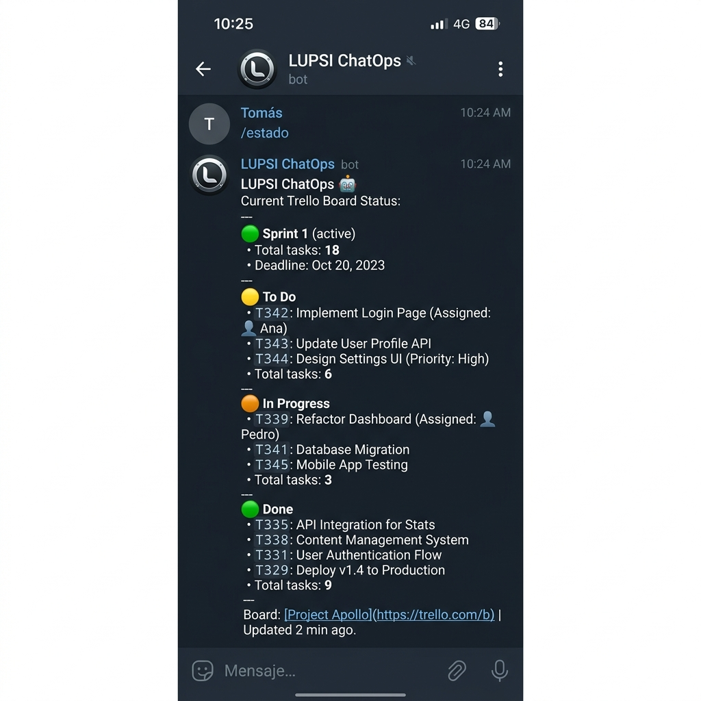
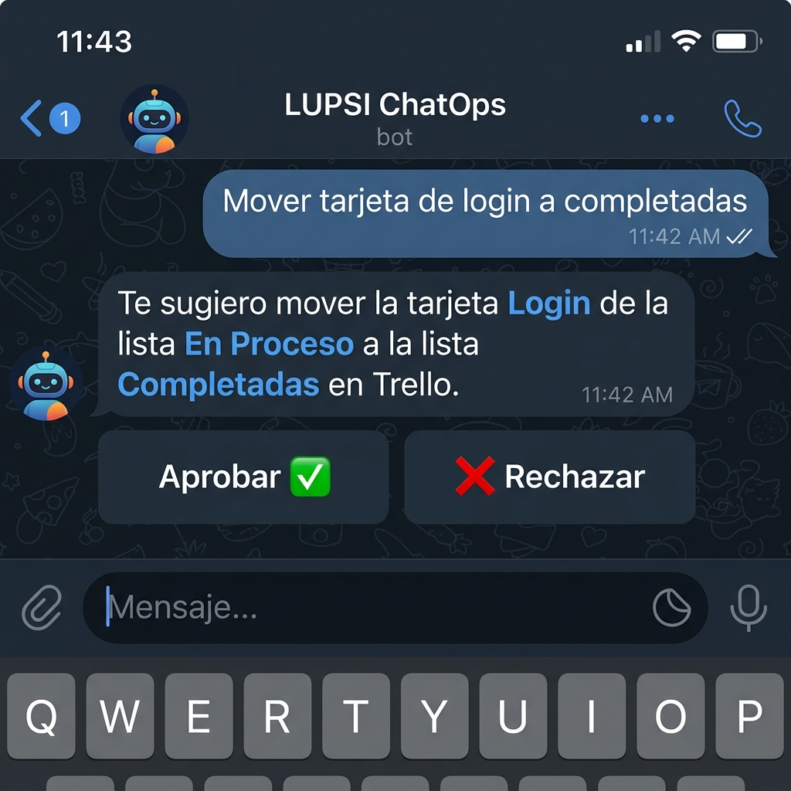
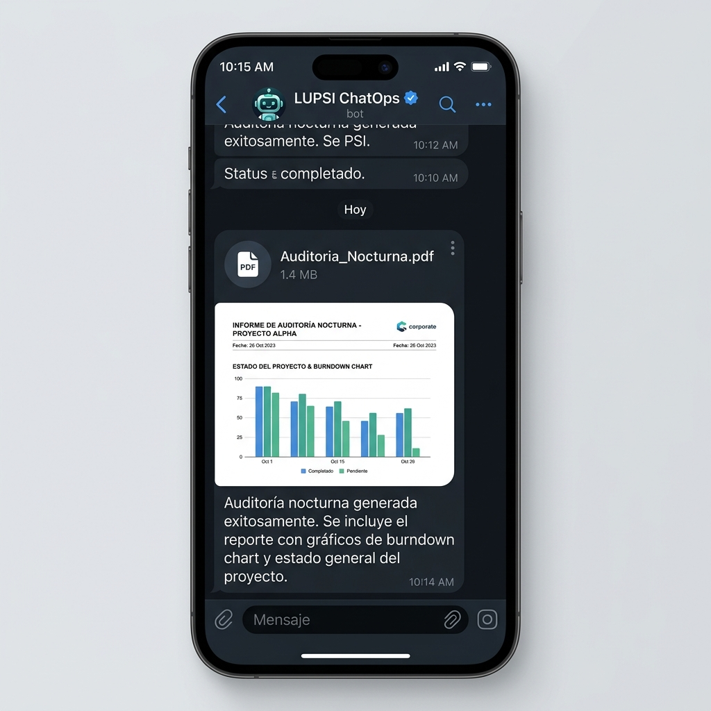

# 🤖 LUPSI ChatOps — Autonomous AI Project Manager Bot

<p align="center">
  
</p>

<p align="center">
  <strong>Agente Autónomo de Inteligencia Artificial para ChatOps y Gestión Ágil de Proyectos de Software en Telegram</strong>
</p>

<p align="center">
  
  
  
  
  
  
  
  
  
</p>

---

## 📋 Tabla de Contenidos

1. [Acerca del Proyecto](#-acerca-del-proyecto)
2. [Características Principales](#-características-principales)
3. [Arquitectura del Sistema](#-arquitectura-del-sistema)
4. [Galería de Funcionalidades (Telegram UI)](#-galería-de-funcionalidades-telegram-ui)
5. [Stack Tecnológico](#-stack-tecnológico)
6. [Comandos del Bot](#-comandos-del-bot)
7. [Requisitos Previos](#-requisitos-previos)
8. [Instalación y Configuración](#-instalación-y-configuración)
9. [Variables de Entorno](#-variables-de-entorno)
10. [Estructura del Repositorio](#-estructura-del-repositorio)
11. [Despliegue en la Nube (Docker & Render)](#-despliegue-en-la-nube-docker--render)
12. [Seguridad y Buenas Prácticas](#-seguridad-y-buenas-prácticas)
13. [Autor](#-autor)

---

## 💡 Acerca del Proyecto

**LUPSI ChatOps** es un agente autónomo de Inteligencia Artificial desarrollado sobre **NestJS** y **TypeScript**, diseñado para operar como el **Project Manager virtual y centro neurálgico de operaciones (ChatOps)** para equipos de desarrollo ágil (Scrum).

El bot centraliza toda la comunicación operativa en **Telegram**, sincronizando en tiempo real tableros de **Trello**, eventos de repositorios en **GitHub**, base de datos persistente en **Supabase** y un motor de **RAG (Retrieval-Augmented Generation)** que indexa la documentación y entregables del proyecto (archivos PDF y Markdown).

### 🎯 Problema que Resuelve
En la gestión de proyectos de software tradicionales, los desarrolladores y líderes pierden tiempo actualizando manualmente tableros, consultando especificaciones en carpetas dispersas y redactando reportes de estado. **LUPSI ChatOps** automatiza estas tareas:
- Consulta en lenguaje natural el estado de cualquier sprint, tarea o miembro del equipo.
- Detecta tareas bloqueadas o vencidas y sugiere acciones correctivas.
- Ejecuta stand-ups diarios automáticos y audita la coherencia entre lo que el desarrollador reporta y lo que realmente sube a GitHub y Trello.
- Requiere confirmación humana (**Human-in-the-Loop**) antes de ejecutar mutaciones críticas.
- Genera y despacha informes ejecutivos en formato **PDF** con métricas y gráficas burndown directo al chat.

---

## ✨ Características Principales

### 🧠 Orquestador de IA Multiprovedor con Failover
- **Enrutamiento inteligente:** Conexión con **OpenRouter** y **NVIDIA NIM** para acceder a LLMs de última generación (Claude 3.5 Sonnet, Llama 3.3 70B, DeepSeek).
- **Alta disponibilidad y tolerancia a fallos:** Detección automática de límites de cuota diaria (rate limits) y failover instantáneo entre múltiples llaves de API y modelos gratuitos de respaldo.

### 📚 Motor RAG sobre Documentación del Proyecto
- Indexación y fragmentación automática en memoria de especificaciones de requisitos, actas, manuales y entregables en formato PDF mediante `pdf-parse`.
- Búsqueda semántica y por relevancia contextual que permite al bot responder dudas técnicas y de negocio citando las fuentes del proyecto.

### 🔄 Sincronización Bidireccional Trello & GitHub
- **Trello API:** Lectura de tableros, listas y tarjetas; asignación de miembros; movimiento de tareas; cálculo de días de holgura y fechas de vencimiento.
- **GitHub API & Webhooks:** Notificaciones de nuevos commits, apertura/cierre de Pull Requests, creación de Issues y alertas críticas si un workflow de CI/CD falla.

### 🛡️ Gobernanza con Human-in-the-Loop (HITL)
- Las operaciones con impacto en el flujo de trabajo (mover una tarea a *Done*, reasignar responsables o crear incidencias) presentan **botones interactivos de confirmación** en Telegram para que el Gestor del Proyecto apruebe o rechace la acción antes de ejecutarla.

### 📊 Generador Dinámico de Reportes PDF
- Motor de maquetación vectorial basado en `pdfkit` que genera informes ejecutivos profesionales con cabeceras estilizadas, tablas de estado, control de cambios y gráficas Burndown.

### ⏰ Automatizaciones Programadas (Cron Jobs)
- `@nestjs/schedule` orquesta rutinas en segundo plano:
  - **Stand-up matutino:** Pregunta individualmente a cada miembro su avance del día anterior, plan de hoy y bloqueos.
  - **Auditoría de consistencia:** Cruza las respuestas del stand-up contra la actividad real en Trello y GitHub.
  - **Detección de estancamiento:** Alerta automática cuando una tarea permanece más de 48 horas sin actividad.

---

## 🏛️ Arquitectura del Sistema

```mermaid
flowchart TD
    User([Usuario / Desarrollador]) <-->|Mensajes y Comandos| TG[Telegram Bot API / Telegraf]
    
    subgraph Core ["LUPSI ChatOps (NestJS Engine)"]
        BS[Bot Service] <--> AI[AI Orchestrator Service]
        AI <--> RAG[Docs & RAG Service]
        AI <--> TS[Trello Service]
        AI <--> GS[GitHub Service]
        AI <--> HITL[HITL Approval Flow]
        
        CRON[Cron & Schedule Service] -->|Standup & Audits| BS
        PDF[PDF Generator Service] -->|Archivos PDF| BS
        SB[Supabase Service] <-->|Persistencia| BS
    end

    subgraph External ["Servicios Cloud y APIs Externas"]
        AI <-->|LLMs Multi-Key| LLM[OpenRouter / NVIDIA NIM]
        RAG <-->|Indexación| KNOWLEDGE[(Base de Conocimiento PDFs)]
        TS <-->|REST API & Webhooks| TRELLO[Trello Boards]
        GS <-->|REST API & Webhooks| GITHUB[GitHub Repo & CI/CD]
        SB <-->|PostgreSQL| SUPABASE[(Supabase DBaaS)]
    end

    WH[Webhook Controller] <-- Webhooks CI/CD & Events --- GITHUB
    WH <-- Webhooks Cards --- TRELLO
    WH --> BS
```

> Para más detalles técnicos, consulta el documento complementario: [ARQUITECTURA_Y_TECNOLOGIAS.md](ARQUITECTURA_Y_TECNOLOGIAS.md).

---

## 📸 Galería de Funcionalidades (Telegram UI)

| Estado en Tiempo Real del Sprint | Human-in-the-Loop (HITL) | Reportes Ejecutivos en PDF |
| :---: | :---: | :---: |
|  |  |  |
| *Resumen consolidado de tareas, miembros asignados y días de holgura.* | *Solicitud interactiva de confirmación antes de mutar tableros.* | *Generación y envío instantáneo de informes formales con métricas.* |

---

## 💻 Stack Tecnológico

| Capa | Tecnología | Propósito |
| :--- | :--- | :--- |
| **Backend Framework** | [NestJS](https://nestjs.com/) v11 | Arquitectura modular basada en inyección de dependencias y TypeScript. |
| **Lenguaje** | [TypeScript](https://www.typescriptlang.org/) v5.7 | Tipado estático y robustez en tiempo de compilación. |
| **Mensajería** | [Telegraf](https://telegraf.js.org/) v4.16 | Integración con la API oficial de Telegram Bots. |
| **Inteligencia Artificial** | [OpenRouter](https://openrouter.ai/) & [NVIDIA NIM](https://build.nvidia.com/) | Acceso a LLMs (Claude 3.5 Sonnet, Llama 3.3 70B, DeepSeek) con failover. |
| **Procesamiento Documental** | `pdfkit` & `pdf-parse` | Extracción de texto para RAG y generación de reportes vectoriales en PDF. |
| **Base de Datos** | [Supabase](https://supabase.com/) | Backend-as-a-Service con PostgreSQL para almacenamiento de estados y analíticas. |
| **Gestión de Proyectos** | [Trello REST API](https://developer.atlassian.com/cloud/trello/) | Monitoreo y control de tableros Kanban. |
| **Control de Versiones** | [GitHub REST API](https://docs.github.com/rest) | Trazabilidad de commits, pull requests, issues y alertas de CI/CD. |
| **Automatización** | `@nestjs/schedule` | Ejecución de tareas programadas (Standups, cronjobs matutinos). |
| **Infraestructura Cloud** | [Docker](https://www.docker.com/) & [Render](https://render.com/) | Empaquetado en contenedor multi-stage y despliegue continuo en la nube. |

---

## ⌨️ Comandos del Bot

| Comando | Descripción |
| :--- | :--- |
| `/start` | Inicializa la sesión con el bot y presenta el mensaje de bienvenida contextual. |
| `/menu` | Despliega el menú interactivo con botones de acceso rápido a las principales funciones. |
| `/estado` | Consulta en tiempo real el estado del tablero de Trello y la actividad en GitHub. |
| `/sprint` | Muestra el progreso del sprint actual (historias completadas vs. pendientes, fechas límites). |
| `/pdf` | Genera y envía un informe ejecutivo en PDF con métricas, burndown y estado del equipo. |
| `/recargar` | Fuerza la relectura e indexación en memoria de los documentos de la base de conocimiento. |
| `/ayuda` | Guía de uso y listado de preguntas frecuentes que el bot puede responder en lenguaje natural. |

> **Nota:** Además de los comandos barra (`/`), puedes interactuar con el bot en **lenguaje natural**. Por ejemplo:
> - *"¿Qué tareas tiene pendientes Alex para este sprint?"*
> - *"¿Hay alguna tarea con fecha vencida o en riesgo?"*
> - *"¿Qué dice el documento de arquitectura sobre la autenticación?"*

---

## 📦 Requisitos Previos

Asegúrate de contar con las siguientes herramientas instaladas:
- [Node.js](https://nodejs.org/) `>= 20.x`
- [npm](https://www.npmjs.com/) `>= 10.x`
- [Git](https://git-scm.com/)
- Cuenta y credenciales en:
  - Telegram (Token creado en [@BotFather](https://t.me/botfather))
  - Trello Developer API Key y Token
  - GitHub Personal Access Token
  - OpenRouter API Key (o NVIDIA NIM)
  - Supabase (URL y Clave de API)

---

## 🚀 Instalación y Configuración

### 1. Clonar el Repositorio
```bash
git clone https://github.com/T1Angel4220/AgenteTelegram.git
cd AgenteTelegram/lupsi-chatops
```

### 2. Instalar Dependencias
```bash
npm install
```

### 3. Configurar Variables de Entorno
Copia el archivo de plantilla `.env.example` a `.env`:
```bash
cp .env.example .env
```
Edita `.env` con tus credenciales (revisa la sección de [Variables de Entorno](#-variables-de-entorno)).

### 4. Compilar y Ejecutar en Desarrollo
```bash
# Modo desarrollo con recarga automática
npm run start:dev

# Modo producción compilado
npm run build
npm run start:prod
```

### 5. Ejecutar Pruebas
```bash
# Pruebas unitarias
npm run test

# Pruebas End-to-End (E2E)
npm run test:e2e
```

---

## 🔐 Variables de Entorno

El proyecto incluye una plantilla `.env.example` preconfigurada con documentación detallada. Las variables esenciales son:

| Variable | Requerida | Descripción | Ejemplo / Formato |
| :--- | :---: | :--- | :--- |
| `TELEGRAM_TOKEN` | Sí | Token del bot provisto por @BotFather. | `123456789:ABCDefGhIJKlm...` |
| `TELEGRAM_CHAT_ID` | Sí | Chat ID del grupo o admin para alertas. | `-1001234567890` |
| `TRELLO_KEY` | Sí | API Key de desarrollador de Trello. | Cadena alfanumérica de 32 chars |
| `TRELLO_TOKEN` | Sí | Token de servidor de Trello. | Token OAuth de 64 chars |
| `BOARD_ID` | Sí | ID del tablero de Trello a monitorear. | ID alfanumérico del tablero |
| `GITHUB_TOKEN` | Sí | Personal Access Token con acceso a repos. | `ghp_xxxxxxxxxxxx` |
| `GITHUB_OWNER` | Sí | Usuario u organización del repo en GitHub. | `A1EXF6A` |
| `GITHUB_REPO` | Sí | Nombre del repositorio monitoreado. | `Lupsi` |
| `OPENROUTER_API_KEY` | Sí | Llave principal para consumo de LLMs. | `sk-or-v1-xxxxxxxxxxxx` |
| `AI_KEYS` | Opcional | Lista de llaves OpenRouter para failover. | `sk-or-...,sk-or-...` |
| `AI_MODELS` | Opcional | Modelos de OpenRouter priorizados. | `anthropic/claude-3.5-sonnet` |
| `NVIDIA_API_KEY` | Opcional | Llave de NVIDIA NIM para inferencia rápida. | `nvapi-xxxxxxxxxxxx` |
| `SUPABASE_URL` | Sí | URL del proyecto Supabase. | `https://xyz.supabase.co` |
| `SUPABASE_KEY` | Sí | Clave service o anon de Supabase. | `eyJhbGciOi...` |

---

## 📁 Estructura del Repositorio

```text
lupsi-chatops/
├── conocimiento/               # Base de conocimiento (Markdown y entregables PDF)
│   ├── base_conocimiento.md    # Especificación general del proyecto y reglas
│   ├── cronograma_oficial.md   # Hitos y fechas oficiales de sprints
│   └── manual_comportamiento.md# Guía de estilo y tono para el agente
├── public/                     # Archivos estáticos
│   └── index.html              # Landing informativa del microservicio
├── src/                        # Código fuente modular en NestJS
│   ├── ai.service.ts           # Orquestación de LLMs, failovers y superprompts
│   ├── autonomy.service.ts     # Módulo de decisiones autónomas del agente
│   ├── bot.service.ts          # Controlador del bot de Telegram, menú y comandos
│   ├── consistency.service.ts  # Auditoría de coherencia (Standup vs Trello vs Git)
│   ├── cron.service.ts         # Tareas programadas, standups diarios y recordatorios
│   ├── docs.service.ts         # Extracción de PDF y motor de búsqueda RAG
│   ├── github.service.ts       # Integración con la API de GitHub
│   ├── pdf.service.ts          # Generador de reportes vectoriales en PDF (PDFKit)
│   ├── supabase.service.ts     # Capa de persistencia con base de datos PostgreSQL
│   ├── trello.service.ts       # Integración con la API de Trello
│   ├── webhook.controller.ts   # Endpoints para webhooks de GitHub y Trello
│   ├── app.module.ts           # Módulo raíz de la aplicación NestJS
│   └── main.ts                 # Punto de entrada y arranque del servidor
├── test/                       # Pruebas automatizadas (Jest)
│   └── app.e2e-spec.ts         # Pruebas End-to-End
├── .env.example                # Plantilla documentada de variables de entorno
├── .gitignore                  # Reglas estrictas de exclusión de secretos y temporales
├── ARQUITECTURA_Y_TECNOLOGIAS.md # Documento técnico de arquitectura detallada
├── nest-cli.json               # Configuración del CLI de NestJS
├── package.json                # Dependencias y scripts del proyecto
└── tsconfig.json               # Configuración del compilador TypeScript
```

---

## 🐳 Despliegue en la Nube (Docker & Render)

El proyecto está preparado para ejecutarse en entornos contenerizados con **Docker**.

### Dockerfile Recomendado (Multi-Stage Build)
```dockerfile
# Stage 1: Build
FROM node:20-alpine AS builder
WORKDIR /app
COPY package*.json ./
RUN npm ci
COPY . .
RUN npm run build

# Stage 2: Runtime
FROM node:20-alpine AS runner
WORKDIR /app
ENV NODE_ENV=production
COPY package*.json ./
RUN npm ci --only=production
COPY --from=builder /app/dist ./dist
COPY --from=builder /app/conocimiento ./conocimiento
COPY --from=builder /app/public ./public

EXPOSE 3000
CMD ["node", "dist/main"]
```

### Despliegue en Render
1. Conecta este repositorio en [Render](https://render.com/).
2. Configura un **Web Service** seleccionando el entorno **Docker** o **Node**.
3. En el panel de **Environment Variables**, añade cada una de las variables descritas en `.env.example`.
4. El servicio compilará automáticamente y quedará en línea escuchando eventos y webhooks en el puerto `3000`.

---
